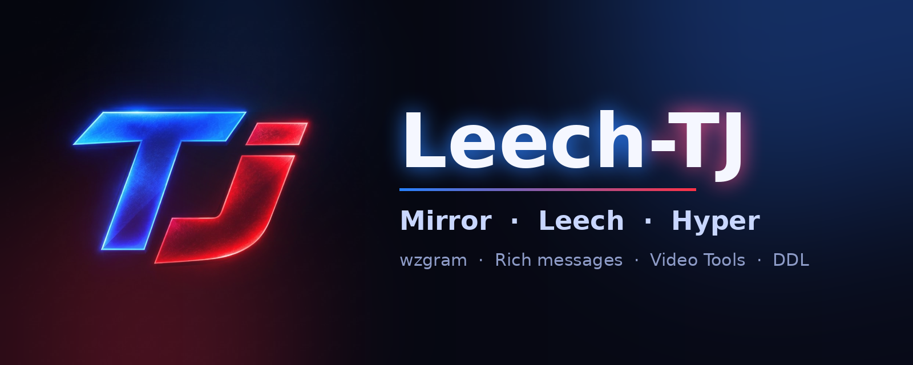

<p align="center">
  
</p>

<p align="center">
  <b>A fast Telegram Mirror / Leech bot with parallel downloads, auto covers, Video Tools and per-user settings.</b><br>
  <sub>Built on <a href="https://github.com/weebzone/WZML-X">WZML-X</a> · runs on <code>wzgram</code> · made by <a href="https://t.me/TJ_Bots">TJ Bots</a></sub>
</p>

<p align="center">
  <a href="https://t.me/Tj_Leech_Group"></a>
  <a href="https://t.me/TJ_Bots"></a>
  
  
</p>

---

## Contents

[Features](#features) · [Install](#install) · [Commands](#commands) · [Args](#args) · [User settings](#user-settings) · [Hyper](#hyper) · [Config variables](#config-variables) · [Credits](#credits)

---

## Features

| | |
|---|---|
| **Fast Telegram downloads** | A premium user session (and optional helper bots) download Telegram files in parallel. See [Hyper](#hyper). |
| **Auto Thumbnail & Cover** | Finds the movie/series poster on TMDB from the file name, in the user's language when it exists, and sets it as thumbnail and as full-quality video cover. |
| **`/cover`** | Reply to a video to send it again with your thumbnail / TMDB poster as cover, without downloading it. |
| **Video Tools `-vt`** | A menu before the task: Rename, Video + Video / Audio / Subtitle, Extract, Remove Stream, Trim, Screenshots, Convert To. Nothing is re-encoded. The owner can add more tools. |
| **Convert & extract audio** | `-cv mp4`, `-ca mp3`, and `-ea` to take the audio out of a video. Videos are remuxed, not re-encoded, when possible. |
| **FFmpeg Cmds** | Save named ffmpeg commands in `/us` and run them with `-ff name`. |
| **Sample & Screenshots** | A short sample clip and screenshots with every leeched video. |
| **DDL hosts** | GoFile and VikingFile (work as guest), PixelDrain, BuzzHeavier, DevUploads, StreamTape. |
| **Rich status** | Optional Telegram Rich messages: Cancel and Select buttons inside every task, confirm before cancel, task overview. |
| **Per-user settings** | Upload destination, transfer mode, caption font, thumbnail layout, rclone, cookies and more in `/us`. |
| **Handy extras** | Telegram link ranges (`/l t.me/c/123/10-25`), Retry button, `/history`, `-sp` split size per task, queue notices. |
| **Themes** | `minimal`, `cool` and `emoji`, all complete. Set with `BOT_THEME`. |

---

## Install

### VPS with Docker Compose (recommended)

```bash
git clone -b wzgram https://github.com/Tj-Bots/Leech-TJ && cd Leech-TJ
cp config_sample.env config.env     # fill BOT_TOKEN, OWNER_ID, TELEGRAM_API, TELEGRAM_HASH, DATABASE_URL
docker compose up -d --build
```

- Service accounts, downloads, thumbnails, rclone configs and cookies are kept on the server (`./accounts`, `./downloads`, `./data/`), so a rebuild does not delete them.
- Ports: `8181` (web) and `8282` (torrent selector). Change them with `LEECH_TJ_WEB_PORT` and `LEECH_TJ_TORRENT_PORT`.
- The bot starts again by itself after a server reboot.

**Updating:** set `UPSTREAM_REPO` and `UPSTREAM_BRANCH` (`wzgram`) in `/bs` or `config.env`, then send `/restart`. New Python packages need a rebuild: `docker compose up -d --build`.

### Heroku (optional)

[](https://colab.research.google.com/github/Tj-Bots/Leech-TJ/blob/wzgram/colab/Leech-TJ-Heroku.ipynb)

Open the notebook, fill the form and run the cells: it creates the app, saves your settings as Config Vars (not in git) and deploys. You can also upload your own `config.env`.

Heroku can suspend accounts that run bots. A VPS is safer.

---

## Commands

| Command | What it does |
|---|---|
| `/mirror` `/m` | Mirror to GDrive, RClone or DDL |
| `/leech` `/l` | Leech to Telegram |
| `/qbmirror` `/qbleech` | The same with qBittorrent |
| `/ytdl` `/ytdlleech` | yt-dlp supported sites |
| `/clone` | Copy GDrive / RClone / GDTot / Filepress / GDFlix links |
| `/cover` | Reply to a video to set its cover |
| `/status` `/s` | Tasks · `/status me` or `/status user_id` for one user |
| `/stats` | Server stats |
| `/history` | Your last 10 finished tasks |
| `/us` | User settings |
| `/bs` | Bot settings (owner) |
| `/users` | Overview with Sudo, Authorized and Blacklisted lists (owner and sudo) |
| `/authlist` `/sudolist` | The authorized and the sudo users (owner and sudo) |
| `/cancel` `/cancelall` | Stop tasks. Everyone for their own, owner and sudo for all |
| `/help` | Everything else |

Send any command without a link (`/l`, `/m`, `/ytdl`) to get a button menu that explains every arg, with examples you can copy.

---

## Args

| Arg | What it does |
|---|---|
| `-n name` | New name |
| `-z` `-e` | Zip, extract (`-e` first, then `-z`) |
| `-up ddl` `-up gd` `-up rc` | Upload destination, or `-up name` for one of your Upload Paths |
| `-i 5` `-b` `-m folder` | Multi links, bulk, same folder |
| `-s` | Select files of a torrent |
| `-cv mp4` `-ca mp3` | Convert videos and audios. `-ca mp3 + flac ogg` only those, `-cv mkv - webm flv` all except those |
| `-ea` `-ea m4a` | Extract the audio of videos |
| `-vt` | Video Tools menu |
| `-ff name` | Run one of your FFmpeg Cmds |
| `-sp 1.5GB` | Split size for this task only |
| `-ss 6` `-t link` | Screenshots, custom thumbnail |
| `-ud name` `-c category` | Dump chat, GDrive category |
| `-j` `-d` `-rcf` | Join splits, seed, rclone flags |

---

## User settings

Everyone tunes the bot for themselves with `/us`, no owner needed.

<details>
<summary><b>Leech</b></summary>

- **Transfer Mode**: `Bot`, `User` (premium session) or `Hyper`
- Send as media or document, Leech Splits, Equal Splits, Media Group
- Custom Thumbnail, **Auto Thumbnail** (TMDB), **Thumbnail Layout** (a grid of frames, like `3x3`)
- **Sample Video** (1-30 seconds) and **Screenshots** (1-10)
- Caption, **Caption Font**, Prefix, Suffix, Remname, Metadata
- **Excluded Extensions**: files that are deleted before upload
- **Media Store**: every leeched file gets a Store Link
- Leech Dumps (your own channels)
</details>

<details>
<summary><b>Mirror</b></summary>

- **Upload To**: GDrive, RClone or DDL, for you only
- RClone config, **RClone Path**, **RClone Flags**
- **Upload Paths**: short names for destinations, used with `-up name`
- DDL Servers, User TDs, **Stop Duplicate**
- Prefix, Suffix, Remname
</details>

<details>
<summary><b>Universal</b></summary>

- YT-DLP Options and your own cookies file
- **FFmpeg Cmds**
- User Session (stored encrypted) and **Mega Login**
- Bot PM, MediaInfo, Save Mode
</details>

---

## Hyper

Hyper makes Telegram **downloads** fast. It is on by default (`USE_HYPER`) and each user picks `Transfer Mode` in `/us`.

1. The bot copies the file to your dump chat (`LEECH_LOG_ID`), so every client can read it.
2. Your **user session** downloads it from there. With `HELPER_TOKENS` or `HELPER_STRINGS` the helpers join in and each takes a part of the file.
3. The copy in the dump chat is deleted when the download is done, and the task goes on as usual.

Uploads do not use helpers: with a premium user session they are sent through it.

**Setup:** set `LEECH_LOG_ID`, add `USER_SESSION_STRING`, and make the user session a member of the dump chat (the bot invites it itself if it has the right to invite users). Helpers are optional: make helper bots **admins** and helper users **members** of the dump chat. If anything fails, the bot downloads normally.

---

## Config variables

All variables can be edited live from `/bs` → Config Variables.

<details>
<summary><b>Main variables</b></summary>

| Variable | Description |
|---|---|
| `BOT_TOKEN` `OWNER_ID` `TELEGRAM_API` `TELEGRAM_HASH` | Required |
| `DATABASE_URL` | MongoDB, keeps settings across restarts |
| `USER_SESSION_STRING` | Premium session: 4GB uploads and fast downloads |
| `LEECH_LOG_ID` | Dump chat for leeched files, needed for Hyper |
| `USE_HYPER` `HELPER_TOKENS` `HELPER_STRINGS` | Hyper |
| `HYPER_THREADS` `HYPER_CHUNK` `HYPER_PIPELINE` | Hyper tuning, leave empty for auto |
| `TMDB_ACCESS_TOKEN` | Auto Thumbnail and `/cover` posters |
| `DEFAULT_UPLOAD` | `gd`, `rc` or `ddl` (each user can pick their own) |
| `RICH_MESSAGES` | Rich status with buttons inside the text |
| `PM_ACCESS` | Everyone can use the bot in private chat |
| `VT_CUSTOM_CMDS` | Extra Video Tools buttons, `name: ffmpeg args` per line |
| `DISABLE_FF_MODE` | Hide FFmpeg Cmds from users |
| `CAP_FONT` | Default caption font (`b`, `i`, `u`, `s`, `code`, `spoiler`) |
| `BOT_THEME` | `minimal`, `cool` or `emoji` |
| `UPSTREAM_REPO` `UPSTREAM_BRANCH` | Where `/restart` updates from |

</details>

---

## Credits

Leech-TJ is a fork of [WZML-X](https://github.com/weebzone/WZML-X), which is based on [mirror-leech-telegram-bot](https://github.com/anasty17/mirror-leech-telegram-bot). Some features were ported from WZML-X `wzv3`.
Licensed under **GPL-3.0**.
