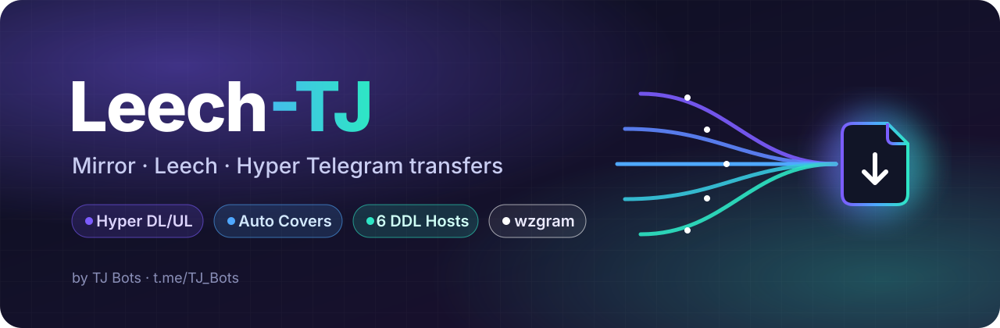

<p align="center">
  
</p>

<p align="center">
  <b>A fast Telegram Mirror / Leech bot with parallel "Hyper" transfers, auto covers and per-user settings.</b><br>
  <sub>Built on <a href="https://github.com/weebzone/WZML-X">WZML-X</a> · runs on <code>wzgram</code> · made by <a href="https://t.me/TJ_Bots">TJ Bots</a></sub>
</p>

<p align="center">
  <a href="https://t.me/Tj_Leech_Group"></a>
  <a href="https://t.me/TJ_Bots"></a>
  
  
</p>

---

## ✨ Highlights

| | |
|---|---|
| ⚡ **Hyper transfers** | Telegram files are split into ranges and pulled by several clients at once (helper bots, helper users and your premium session). Uploads are spread across them too. Falls back to the normal engine on any error. |
| 🎬 **Auto Thumbnail & Cover** | Finds the movie/series poster on TMDB from the file name and sets it as thumbnail **and** full-quality video cover. Your own thumbnail is used as cover too. |
| 🖼️ **`/cover`** | Reply to any video to re-send it with your thumbnail / TMDB poster as cover, instantly, without downloading it again. |
| 🎞️ **Sample & Screenshots** | Optional short sample clip (cut without re-encoding, takes a second) and screenshots uploaded with every leeched video. |
| ☁️ **DDL hosts** | GoFile *(works as guest, no key)*, VikingFile *(guest)*, PixelDrain, BuzzHeavier, DevUploads, StreamTape. |
| 🛠️ **FFmpeg Cmds** | Save named ffmpeg commands and run them on any task with `-ff name`. |
| 🔄 **Convert Media** | `-cv mp4` / `-ca mp3` change formats (videos are remuxed without re-encoding when possible), `-ea` takes the audio out of videos. |
| 💬 **Rich Messages** | Optional Telegram Rich status: Cancel / Select buttons inside every task (with a confirm only you can see), lines between tasks, Store / Share buttons on finished files. |
| 🎨 **TJ style** | Clean blockquote messages, colored buttons (red close, green confirm, blue links) via `wzgram`. |

---

## 👤 User Settings — `/us`

Every user can tune the bot for themselves, no owner needed.

<details>
<summary><b>Leech</b></summary>

- **Transfer Mode** — `Bot` / `User` (premium session) / `Hyper ⚡`
- Send as Media / Document, Leech Splits, Equal Splits, Media Group
- Custom Thumbnail, **Auto Thumbnail** (TMDB), **Thumbnail Layout** (grid of frames, e.g. `3x3`)
- **Sample Video** (1–30 sec) and **Screenshots** (1–10)
- Caption, Prefix, Suffix, Remname, Metadata
- **Excluded Extensions** — files that are deleted before upload
- Leech Dumps (your own channels)
</details>

<details>
<summary><b>Mirror</b></summary>

- RClone config, **RClone Path**, **RClone Flags**
- **Upload Paths** — short names for destinations, use with `-up name`
- DDL Servers, User TDs
- **Stop Duplicate** per user
- Prefix, Suffix, Remname
</details>

<details>
<summary><b>Universal</b></summary>

- YT-DLP Options and your own **YT-DLP Cookies** file
- **FFmpeg Cmds**
- User Session (encrypted), **Mega Login**
- Bot PM, MediaInfo, Save Mode
</details>

---

## ⚡ Hyper setup

1. Set `LEECH_LOG_ID` — files are copied there so every client can read them.
2. Add helpers (optional, more = faster):
   - `HELPER_TOKENS` — extra bot tokens, space separated. Make them **admins** in the dump chat.
   - `HELPER_STRINGS` — extra user sessions (premium is fastest). Make them **members** of the dump chat.
3. `USE_HYPER = True` and restart. The **Hyper Settings ⚡** page in `/bs` shows how many clients are running.

Even with only `USER_SESSION_STRING`, downloads use many requests in parallel.

---

## 🧾 Commands

| Command | What it does |
|---|---|
| `/mirror` `/m` | Mirror links / files / torrents to GDrive, RClone or DDL |
| `/leech` `/l` | Leech to Telegram |
| `/qbmirror` `/qbleech` | Same, with qBittorrent |
| `/ytdl` `/ytdlleech` | yt-dlp supported sites |
| `/clone` | Copy GDrive / RClone / GDTot / Filepress / GDFlix links |
| `/cover` | Reply to a video to set your thumbnail / TMDB poster as cover |
| `/us` | User settings |
| `/bs` | Bot settings (owner) |
| `/status` `/stats` | Tasks and server stats · `/status me` or `/status user_id` for one user's tasks |
| `/cancel` `/cancelall` | Stop tasks |
| `/help` | Everything else |

**Useful args:** `-up ddl` upload to your DDL hosts · `-up name` use an Upload Path · `-ff name` run an FFmpeg Cmd · `-cv mp4` / `-ca mp3` convert · `-ea` extract audio · `-vt` Video Tools menu · `-n` new name · `-z` zip · `-e` extract · `-i 5` multi links · `-b` bulk · `-s` select files.

Send any command without a link (`/l`, `/m`, `/ytdl`...) to get a button menu that explains every arg with examples you can copy.

---

## 🚀 Deploy

```bash
git clone -b wzgram https://github.com/Tj-Bots/Leech-TJ && cd Leech-TJ
cp config_sample.env config.env   # fill BOT_TOKEN, OWNER_ID, TELEGRAM_API, TELEGRAM_HASH
docker compose up -d --build
```

Updating a running bot: set `UPSTREAM_REPO` / `UPSTREAM_BRANCH` and `/restart`.
New Python packages need a rebuild: `docker compose up -d --build`.

<details>
<summary><b>Main config variables</b></summary>

| Variable | Description |
|---|---|
| `BOT_TOKEN`, `OWNER_ID`, `TELEGRAM_API`, `TELEGRAM_HASH` | Required |
| `DATABASE_URL` | MongoDB, keeps settings across restarts |
| `USER_SESSION_STRING` | Premium session for 4GB uploads and faster downloads |
| `LEECH_LOG_ID` | Dump chat for leeched files (needed for Hyper) |
| `USE_HYPER`, `HELPER_TOKENS`, `HELPER_STRINGS` | Hyper transfers |
| `HYPER_THREADS`, `HYPER_CHUNK`, `HYPER_PIPELINE` | Hyper tuning, leave empty for auto |
| `TMDB_ACCESS_TOKEN` | Auto Thumbnail / `/cover` posters |
| `DISABLE_FF_MODE` | Hide FFmpeg Cmds from users |
| `VT_CUSTOM_CMDS` | Extra Video Tools buttons, `name: ffmpeg args` per line |
| `RICH_MESSAGES` | Rich status and finish messages with buttons inside the text |
| `DEFAULT_UPLOAD` | `gd`, `rc` or `ddl` |
| `UPSTREAM_REPO`, `UPSTREAM_BRANCH` | Where `/restart` updates from |

All variables can be edited live from `/bs` → Config Variables.
</details>

---

## 🙏 Credits

Leech-TJ is a fork of [WZML-X](https://github.com/weebzone/WZML-X), based on [mirror-leech-telegram-bot](https://github.com/anasty17/mirror-leech-telegram-bot).
Hyper engine and several features are ported from WZML-X `wzv3`. Licensed under **GPL-3.0**.
